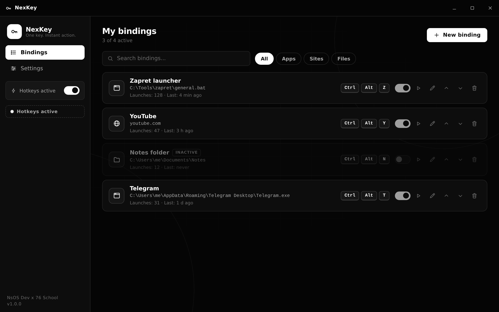
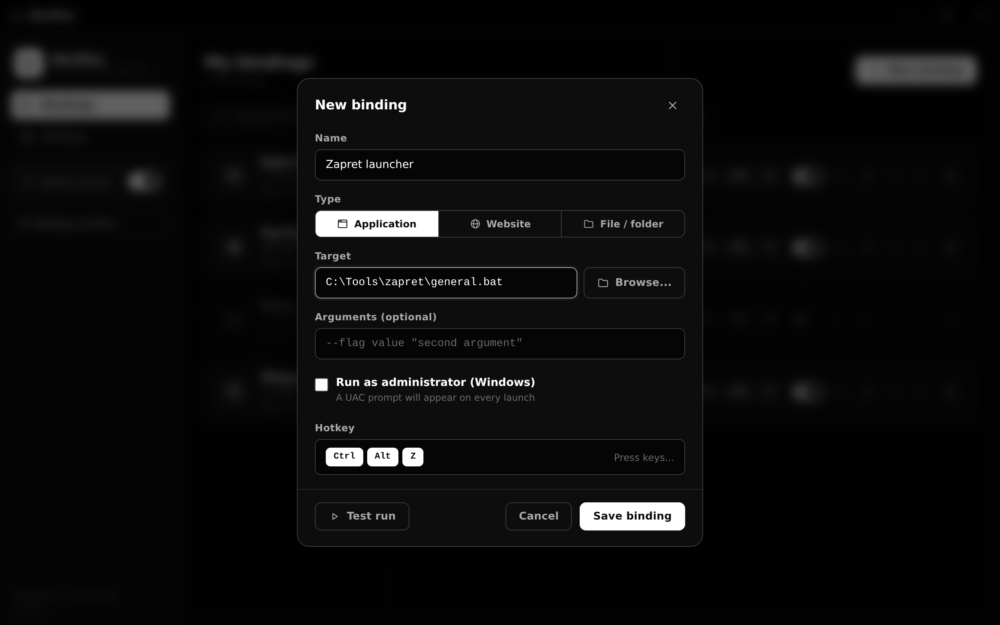
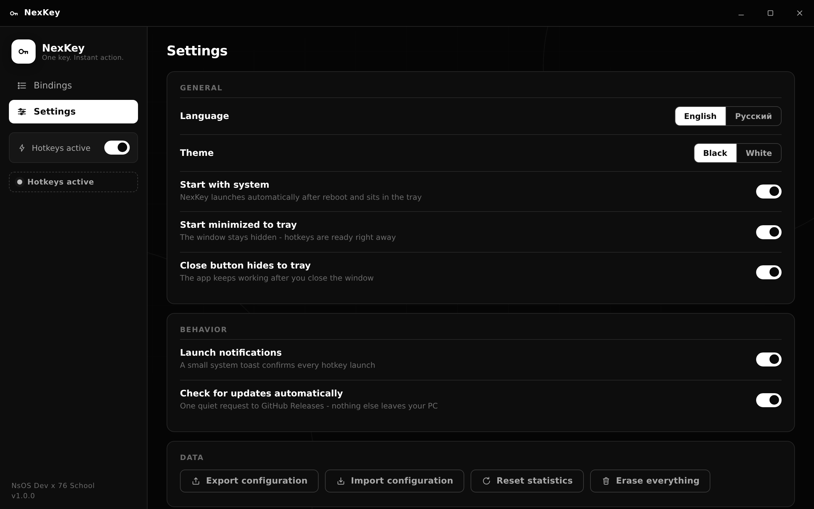
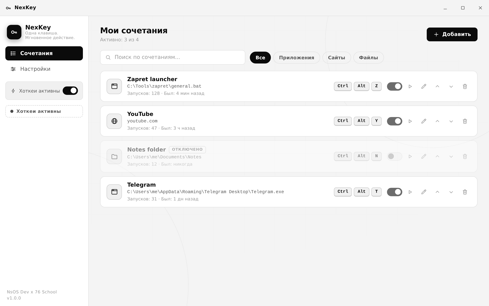

# NexKey

<p align="center">
  
</p>

**NexKey** — instant hotkey launcher for applications, websites and files.
One key press from anywhere in the system — even when the window is closed.
Built to run silently in the background 24/7 with OS autostart.

*One key. Instant action.*

<p align="center">
  
  
  
  
</p>

---

## Contents

- [Why NexKey](#why-nexkey)
- [Features](#features)
- [Screenshots](#screenshots)
- [Installation](#installation)
- [Quick start](#quick-start)
- [How it works](#how-it-works)
- [Build from source](#build-from-source)
- [Project structure](#project-structure)
- [Documentation](#documentation)
- [Roadmap](#roadmap)
- [Credits and contacts](#credits-and-contacts)

## Why NexKey

A typical scenario: you have downloaded [zapret](https://github.com/Flowseal/zapret-discord-youtube) to watch YouTube, and every time you need to open Explorer, find the folder, find `general.bat` and run it. Again and again, every day.

With NexKey you do it once: add a binding, choose the file, press a key combination like `Ctrl+Alt+Z` — and from now on that combination launches it from anywhere: from a game, from a browser, from the lock screen. NexKey starts together with the system and lives in the tray, so your hotkeys survive any reboot.

## Features

- **Three binding types** — application (`.exe`, `.bat`, `.cmd`, `.lnk`, `.app`), website URL, any file or folder.
- **Hotkey recorder** — press any combination, including full modifier combos (`Ctrl`, `Alt`, `Shift`, `Win`/`Cmd`) and F-keys.
- **True background mode** — tray icon, start with system, start minimized, close button hides to tray.
- **Binding manager** — list with active/inactive toggles, pause and resume, edit, reorder, delete, search and type filters.
- **Global pause** — suspend all hotkeys with one switch, resume just as fast.
- **Launch arguments** — pass command-line arguments to applications.
- **Run as administrator** (Windows) — optional elevated launch with UAC prompt.
- **Statistics** — launch counters and last-run time for every binding.
- **Conflict detection** — NexKey tells you when a hotkey is already taken by another application.
- **Two themes** — pure black and pure white. Nothing in between, exactly as intended.
- **Two languages** — English and Russian, switchable on the fly.
- **Export and import** — back up your whole configuration to a JSON file.
- **Update checker** — one quiet request to GitHub Releases; nothing else leaves your PC.
- **First-run onboarding** — three steps and you are ready.
- **No telemetry, no ads, no accounts.** Config lives in a local JSON file.

## Screenshots

| Main window (dark) | New binding dialog |
| --- | --- |
|  |  |

| Settings (English) | Main window (light, Russian) |
| --- | --- |
|  |  |

## Installation

### Option 1 - ready builds (recommended)

1. Open the [Releases](https://github.com/official-ids/NbOS-dev/releases) page.
2. Download `NexKey-Setup-1.0.0.exe` (Windows installer) or `NexKey-1.0.0-portable.exe` (no installation), or the `.dmg` image for macOS.
3. Install and run. That is it.

Detailed guide: [docs/INSTALL_en.md](docs/INSTALL_en.md).

### Option 2 - build it yourself

Requires [Node.js](https://nodejs.org) 18+:

```bash
git clone https://github.com/official-ids/NbOS-dev.git
cd NbOS-dev
npm install
npm run dist:win    # Windows: NSIS installer + portable exe
npm run dist:mac    # macOS: dmg image
```

The finished installers appear in the `dist/` folder. Full instructions: [docs/INSTALL_en.md](docs/INSTALL_en.md).

### Option 3 - GitHub Actions

Every tag `v*` pushed to the repository triggers an automatic build on Windows and macOS runners; the installers are attached to the GitHub Release. You do not need a single tool installed locally.

## Quick start

1. Launch NexKey. It opens the binding list (first run shows a 3-step welcome).
2. Click **New binding**.
3. Choose the type:
   - **Application** — browse to an `.exe`/`.bat` file, add arguments if needed;
   - **Website** — type an address like `youtube.com`;
   - **File / folder** — pick any document or folder.
4. Click the **Hotkey** field and press a combination, for example `Ctrl+Alt+Z`.
5. **Save binding** — done. Press the hotkey anywhere in the system.

Full manual: [docs/HELP_en.md](docs/HELP_en.md).

## How it works

- NexKey registers your combinations via the OS global hotkey API (`globalShortcut`), so they work system-wide.
- The window is optional: closing it (with the default setting) only hides it, the process keeps running in the tray.
- Autostart is a standard OS login item (registry `Run` key on Windows, login items on macOS), no services or drivers are installed.
- All settings and bindings are stored in one JSON file (`config.json`) inside the user data folder. No registry writes besides the standard login item, no hidden files.

## Build from source

| Step | Command | Result |
| --- | --- | --- |
| Install dependencies | `npm install` | `node_modules/` |
| Run in dev mode | `npm start` | dev window |
| Build Windows | `npm run dist:win` | `dist/NexKey-Setup-1.0.0.exe`, `dist/NexKey-1.0.0-portable.exe` |
| Build macOS | `npm run dist:mac` | `dist/NexKey-1.0.0-arm64.dmg`, `dist/NexKey-1.0.0-x64.dmg` |

Requirements: Node.js 18+ (Node 20 recommended), on macOS Xcode command line tools are not required for unsigned builds.

## Project structure

```
NbOS-dev/
├─ src/
│  ├─ main/               Electron main process
│  │  ├─ main.js          window, tray, IPC, lifecycle
│  │  ├─ shortcuts.js     global hotkey manager
│  │  ├─ launcher.js      app/site/file launch logic
│  │  ├─ store.js         JSON config store (atomic saves + backup)
│  │  ├─ autostart.js     OS login item
│  │  └─ updater.js       GitHub Releases update check
│  ├─ preload.js          secure renderer bridge
│  └─ renderer/           UI (vanilla JS, no frameworks)
│     ├─ index.html       markup + SVG icon sprite
│     ├─ styles.css       black & white themes, animations
│     ├─ app.js           view logic
│     ├─ i18n.js          localization helper
│     └─ locales/         en.js, ru.js
├─ build/                 icons, installer license
├─ docs/                  documentation, screenshots, landing page
├─ .github/               CI workflow, issue templates
└─ package.json           build config (electron-builder)
```

## Documentation

| Document | English | Russian |
| --- | --- | --- |
| Install guide | [INSTALL_en.md](docs/INSTALL_en.md) | [INSTALL_ru.md](docs/INSTALL_ru.md) |
| Full manual | [HELP_en.md](docs/HELP_en.md) | [HELP_ru.md](docs/HELP_ru.md) |
| FAQ | [FAQ_en.md](docs/FAQ_en.md) | [FAQ_ru.md](docs/FAQ_ru.md) |
| Quick start (plain text) | [QUICKSTART_en.txt](docs/QUICKSTART_en.txt) | [QUICKSTART_ru.txt](docs/QUICKSTART_ru.txt) |
| Changelog | [CHANGELOG.md](docs/CHANGELOG.md) | |
| Contributing | [CONTRIBUTING.md](docs/CONTRIBUTING.md) | |
| Security | [SECURITY.md](docs/SECURITY.md) | |

## Roadmap

- [ ] Drag-and-drop reordering of bindings
- [ ] Per-binding delay and sequence launches (run several bindings with one key)
- [ ] Sound feedback on launch (optional)
- [ ] Auto-update inside the app
- [ ] Portable config next to the executable

Suggestions are welcome — open an issue or write to the contacts below.

## Credits and contacts

NexKey is developed by **NsOS Dev** with the support of **76 School** — [76school.vercel.app](https://76school.vercel.app).

- Telegram: [@nbsp_acc](https://t.me/nbsp_acc)
- Email: [iamytn@duck.com](mailto:iamytn@duck.com)
- Repository: [github.com/official-ids/NbOS-dev](https://github.com/official-ids/NbOS-dev)
- Project website: [official-ids.github.io/NbOS-dev](https://official-ids.github.io/NbOS-dev/)

License: [MIT](LICENSE). Use it, modify it, share it.
