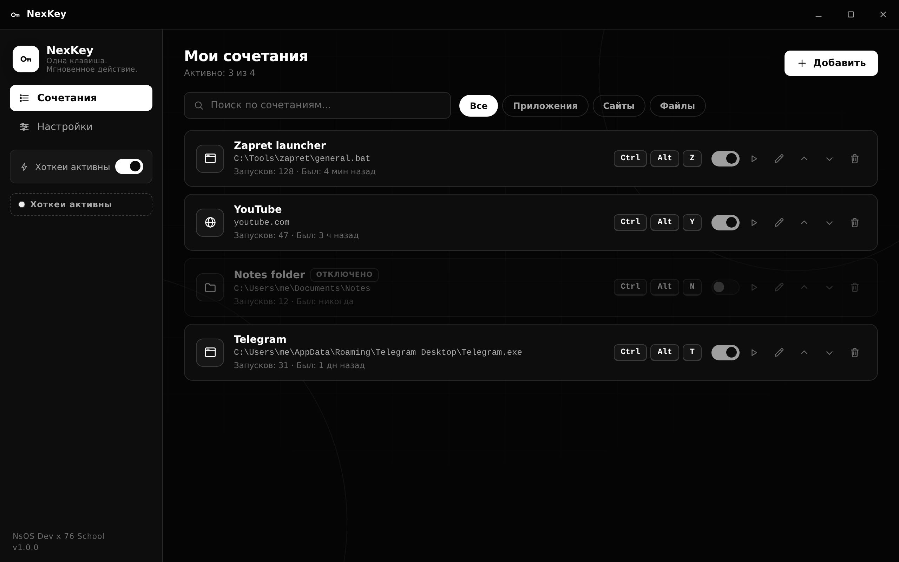
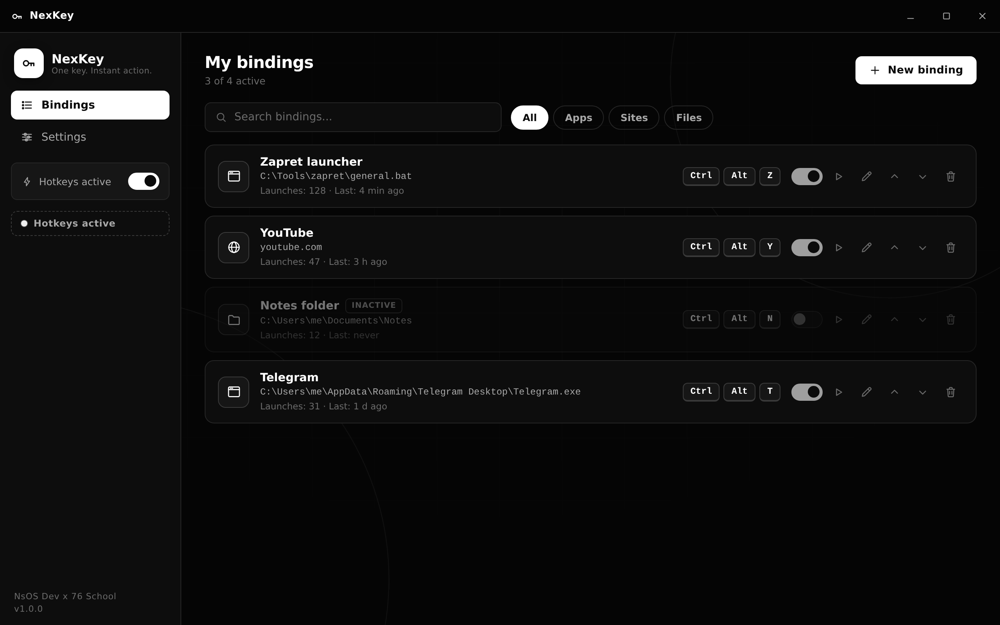
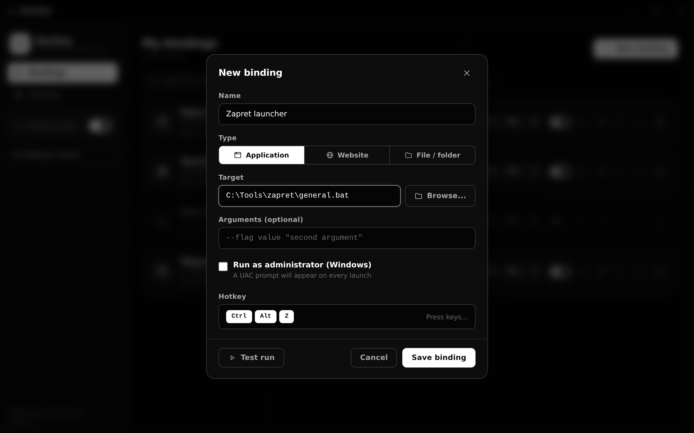
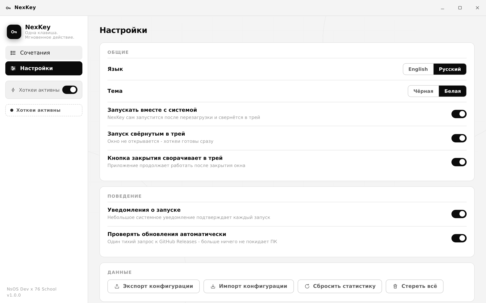
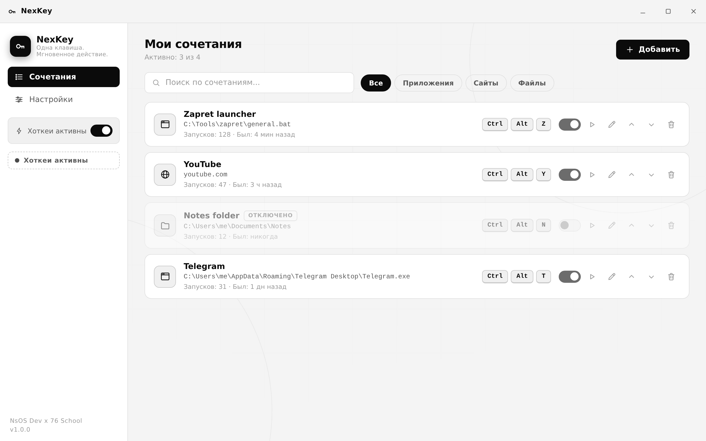

# NexKey

<p align="center">
  
</p>

**NexKey** — мгновенный лаунчер для приложений, сайтов и файлов по горячим клавишам.
Одно нажатие из любого места системы — даже когда окно закрыто.
Программа живёт в фоне 24/7 и стартует вместе с системой.

*Одна клавиша. Мгновенное действие.*

<p align="center">
  
  
  
  
</p>

---

## Содержание

- [Зачем нужен NexKey](#зачем-нужен-nexkey)
- [Возможности](#возможности)
- [Скриншоты](#скриншоты)
- [Установка](#установка)
- [Быстрый старт](#быстрый-старт)
- [Как это работает](#как-это-работает)
- [Сборка из исходников](#сборка-из-исходников)
- [Структура проекта](#структура-проекта)
- [Документация](#документация)
- [Планы](#планы)
- [Авторы и контакты](#авторы-и-контакты)

## Зачем нужен NexKey

Типичная ситуация: вы скачали [zapret](https://github.com/Flowseal/zapret-discord-youtube), чтобы смотреть YouTube, и каждый раз открываете проводник, ищете папку, находите `general.bat` и запускаете его. Каждый день, снова и снова.

С NexKey это делается один раз: добавляете сочетание, выбираете файл, назначаете клавиши вроде `Ctrl+Alt+Z` — и дальше эта комбинация запускает его откуда угодно: из игры, из браузера, из любого окна. NexKey стартует вместе с системой и живёт в трее, поэтому ваши хоткеи переживают любую перезагрузку.

## Возможности

- **Три типа связок** — приложение (`.exe`, `.bat`, `.cmd`, `.lnk`, `.app`), адрес сайта, любой файл или папка.
- **Рекордер хоткеев** — нажмите любое сочетание, включая комбинации с `Ctrl`, `Alt`, `Shift`, `Win`/`Cmd` и F-клавиши.
- **Настоящий фоновый режим** — иконка в трее, автозапуск с системой, запуск свёрнутым, кнопка закрытия сворачивает в трей.
- **Менеджер сочетаний** — список с переключателями вкл/выкл, пауза и продолжение, изменение, перемещение, удаление, поиск и фильтры по типу.
- **Глобальная пауза** — приостановить все хоткеи одним переключателем и так же быстро возобновить.
- **Аргументы запуска** — передайте параметр командной строки приложению.
- **Запуск от администратора** (Windows) — опционально, с запросом UAC.
- **Статистика** — счётчик запусков и время последнего запуска для каждой связки.
- **Поиск конфликтов** — NexKey предупредит, если хоткей уже занят другим приложением.
- **Две темы** — чисто чёрная и чисто белая. Ничего промежуточного, как и задумано.
- **Два языка** — русский и английский, переключение на лету.
- **Экспорт и импорт** — резервная копия всей конфигурации в JSON-файл.
- **Проверка обновлений** — один тихий запрос к GitHub Releases; больше ничего с ПК не уходит.
- **Онбординг при первом запуске** — три шага, и вы готовы.
- **Без телеметрии, рекламы и аккаунтов.** Конфигурация лежит в локальном JSON-файле.

## Скриншоты

| Главное окно (чёрная тема) | Новая связка |
| --- | --- |
|  |  |

| Настройки (русский) | Главное окно (белая тема, английский) |
| --- | --- |
|  |  |

## Установка

### Способ 1 - готовые сборки (рекомендуется)

1. Откройте страницу [Releases](https://github.com/official-ids/NbOS-dev/releases).
2. Скачайте `NexKey-Setup-1.0.0.exe` (установщик для Windows), `NexKey-1.0.0-portable.exe` (без установки) или `.dmg` для macOS.
3. Установите и запустите. Готово.

Подробная инструкция: [docs/INSTALL_ru.md](docs/INSTALL_ru.md).

### Способ 2 - собрать самому

Нужен [Node.js](https://nodejs.org) 18+:

```bash
git clone https://github.com/official-ids/NbOS-dev.git
cd NbOS-dev
npm install
npm run dist:win    # Windows: установщик NSIS + portable exe
npm run dist:mac    # macOS: образ dmg
```

Готовые установщики появятся в папке `dist/`. Полная инструкция: [docs/INSTALL_ru.md](docs/INSTALL_ru.md).

### Способ 3 - GitHub Actions

Каждый тег `v*`, отправленный в репозиторий, запускает автоматическую сборку на раннерах Windows и macOS; установщики прикрепляются к релизу на GitHub. Локально ничего ставить не нужно.

## Быстрый старт

1. Запустите NexKey. Откроется список сочетаний (при первом запуске — приветствие из 3 шагов).
2. Нажмите **Добавить**.
3. Выберите тип:
   - **Приложение** — укажите файл `.exe`/`.bat`, при необходимости добавьте аргументы;
   - **Сайт** — введите адрес, например `youtube.com`;
   - **Файл / папка** — выберите любой документ или папку.
4. Нажмите на поле **Горячая клавиша** и задайте сочетание, например `Ctrl+Alt+Z`.
5. **Сохранить** — готово. Нажимайте хоткей из любого места системы.

Полное руководство: [docs/HELP_ru.md](docs/HELP_ru.md).

## Как это работает

- NexKey регистрирует сочетания через системный API глобальных хоткеев (`globalShortcut`), поэтому они работают по всей системе.
- Окно необязательно: по умолчанию его закрытие лишь прячет окно, процесс продолжает работать в трее.
- Автозапуск — стандартный элемент входа в ОС (ключ реестра `Run` в Windows, элементы входа в macOS). Службы и драйверы не устанавливаются.
- Все настройки и связки хранятся в одном JSON-файле (`config.json`) в папке пользовательских данных. Никаких записей в реестр, кроме стандартного автозапуска, и никаких скрытых файлов.

## Сборка из исходников

| Шаг | Команда | Результат |
| --- | --- | --- |
| Установка зависимостей | `npm install` | `node_modules/` |
| Запуск в режиме разработки | `npm start` | окно приложения |
| Сборка Windows | `npm run dist:win` | `dist/NexKey-Setup-1.0.0.exe`, `dist/NexKey-1.0.0-portable.exe` |
| Сборка macOS | `npm run dist:mac` | `dist/NexKey-1.0.0-arm64.dmg`, `dist/NexKey-1.0.0-x64.dmg` |

Требования: Node.js 18+ (рекомендуется Node 20); для неподписанной сборки на macOS инструменты Xcode не нужны.

## Структура проекта

```
NbOS-dev/
├─ src/
│  ├─ main/               главный процесс Electron
│  │  ├─ main.js          окно, трей, IPC, жизненный цикл
│  │  ├─ shortcuts.js     менеджер глобальных хоткеев
│  │  ├─ launcher.js      логика запуска приложений, сайтов и файлов
│  │  ├─ store.js         JSON-хранилище (атомарная запись + резервная копия)
│  │  ├─ autostart.js     элемент входа ОС
│  │  └─ updater.js       проверка обновлений GitHub Releases
│  ├─ preload.js          безопасный мост для интерфейса
│  └─ renderer/           UI (чистый JS, без фреймворков)
│     ├─ index.html       разметка + SVG-иконки
│     ├─ styles.css       чёрно-белые темы, анимации
│     ├─ app.js           логика интерфейса
│     ├─ i18n.js          помощник локализации
│     └─ locales/         en.js, ru.js
├─ build/                 иконки, лицензия установщика
├─ docs/                  документация, скриншоты, лендинг
├─ .github/               CI-воркфлоу, шаблоны задач
└─ package.json           конфигурация сборки (electron-builder)
```

## Документация

| Документ | Русский | English |
| --- | --- | --- |
| Установка | [INSTALL_ru.md](docs/INSTALL_ru.md) | [INSTALL_en.md](docs/INSTALL_en.md) |
| Полное руководство | [HELP_ru.md](docs/HELP_ru.md) | [HELP_en.md](docs/HELP_en.md) |
| Вопросы и ответы | [FAQ_ru.md](docs/FAQ_ru.md) | [FAQ_en.md](docs/FAQ_en.md) |
| Быстрый старт (текст) | [QUICKSTART_ru.txt](docs/QUICKSTART_ru.txt) | [QUICKSTART_en.txt](docs/QUICKSTART_en.txt) |
| История изменений | [CHANGELOG.md](docs/CHANGELOG.md) | |
| Участие в проекте | [CONTRIBUTING.md](docs/CONTRIBUTING.md) | |
| Безопасность | [SECURITY.md](docs/SECURITY.md) | |

## Планы

- [ ] Перетаскивание связок мышью (drag-and-drop)
- [ ] Задержки и цепочки запусков (несколько связок одной клавишей)
- [ ] Звуковое подтверждение запуска (опционально)
- [ ] Обновление прямо внутри приложения
- [ ] Портативная конфигурация рядом с исполняемым файлом

Предложения приветствуются — создайте issue или напишите на контакты ниже.

## Авторы и контакты

NexKey разработан командой **NsOS Dev** при поддержке **76 Школы** — [76school.vercel.app](https://76school.vercel.app).

- Telegram: [@nbsp_acc](https://t.me/nbsp_acc)
- Email: [iamytn@duck.com](mailto:iamytn@duck.com)
- Репозиторий: [github.com/official-ids/NbOS-dev](https://github.com/official-ids/NbOS-dev)
- Сайт проекта: [official-ids.github.io/NbOS-dev](https://official-ids.github.io/NbOS-dev/)

Лицензия: [MIT](LICENSE). Используйте, изменяйте, делитесь.
